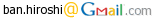
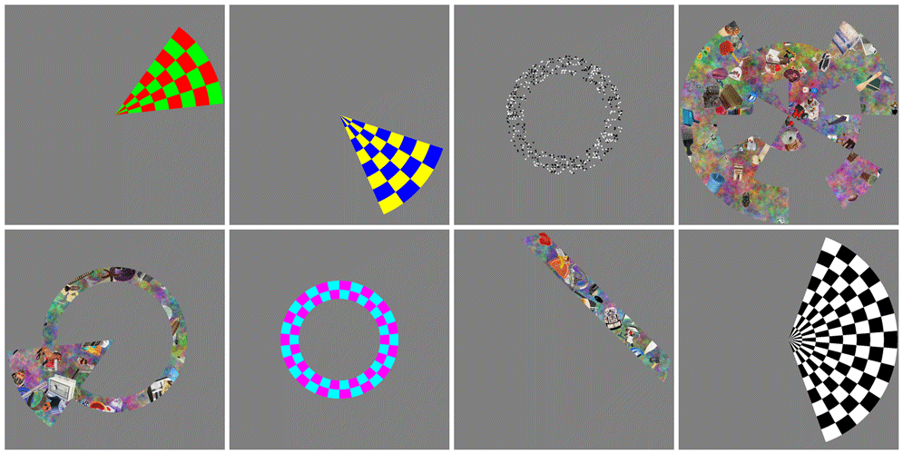
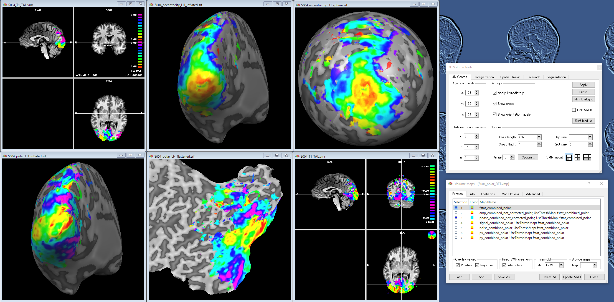
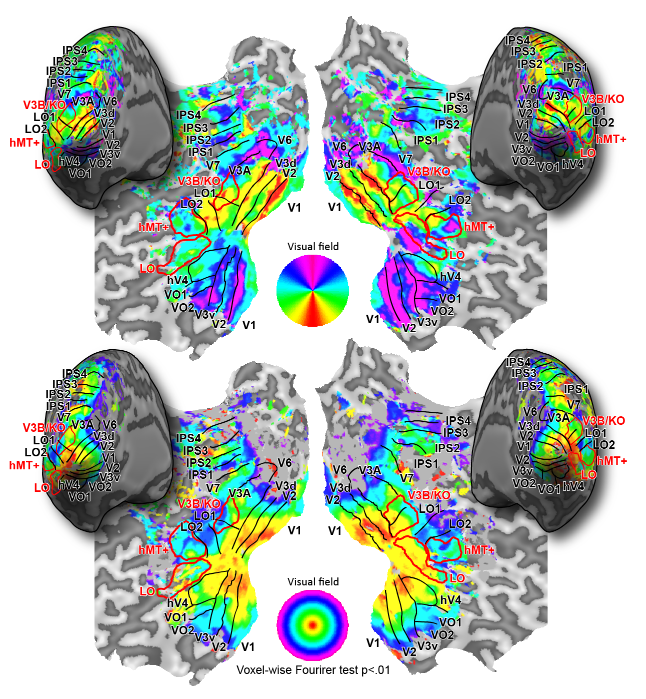
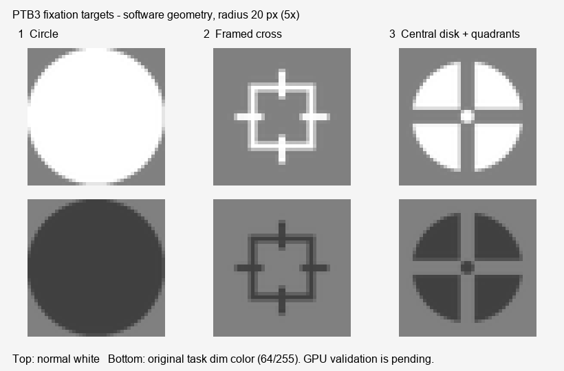

# PyRetinotopy

[English](README.md) | [Japanese](README_ja.md)

<div align="right">
Original Retinotopy created: "2013-11-25 Hiroshi Ban"<br>
Python/PsychoPy adaptation: "2026-11-06"<br>
Last Update: "2026-11-13"
</div>

<br>
<div align="center">


<br>
<br>
 
</div>
<br>

**PyRetinotopy is a Python/PsychoPy adaptation of the MATLAB Psychtoolbox 3 Retinotopy stimulus set ([https://github.com/hiroshiban/Retinotopy](https://github.com/hiroshiban/Retinotopy)), developed and publicly released by Hiroshi Ban. The MATLAB Psychtoolbox 3 version was rewritten in Python for PsychoPy with support from OpenAI's generative AI tools, including Codex.**

Hiroshi Ban, author and responsible investigator of PyRetinotopy, reviews the transfer of functionality from the original MATLAB/PTB3 Retinotopy and performs operational checks throughout development. He is responsible for the software and its release.

The current version is **0.4.0**. The aim is to retain the original PTB3 experiment-facing functionality while replacing MATLAB/Psychtoolbox with Python/PsychoPy. Different implementation procedures are used where they improve timing, reproducibility or data preservation. [The feature correspondence](docs/PTB3_FEATURES.md) and [all 96 referenced settings](docs/PTB3_PARAMETER_MAP.md) document the correspondence and explicit limits. Initial positions and scan order now follow the original PTB3 source formulas; see [spatial compatibility](docs/PTB3_PARITY.md). Core stimuli and binocular presentation paths have been implemented. Object-image presentation uses native NumPy data and movies prepared before acquisition. Before collecting experimental data, check stimulus timing, eye assignment, and calibration on the intended scanner/display hardware.

Documentation:

- [Usage guide](docs/USAGE.md)
- [Participant settings](subjects/README.md)
- [Presentation timing and block boundaries](docs/PRESENTATION_TIMING.md)
- [PTB3 feature correspondence](docs/PTB3_FEATURES.md)
- [Original-to-Python setting mapping](docs/PTB3_PARAMETER_MAP.md)
- [Starting positions and compatibility](docs/PTB3_PARITY.md)

The project and experiment guides introduce PyRetinotopy, its author and purpose, setup, binocular presentation, image preparation, acquisition, timing checks, citation, and acknowledgments: [Japanese PDF](docs/PyRetinotopy_Experiment_Guide_ja.pdf) / [English PDF](docs/PyRetinotopy_Experiment_Guide_en.pdf).

***

# <a name = "Menu"> **Menu** </a>

- [Introduction – what is PyRetinotopy ?](#Introduction)
- [System requirements](#System)
- [How to run PyRetinotopy](#Launch)
  - [Detailed descriptions of the PyRetinotopy](#Details)
  - [About the display configuration](#Displayfile)
  - [About the stimulus configuration](#Stimulusfile)
- [Acknowledgments](#Acknowledgments)
- [License](#License)
- [Citation](#Citation)
- [References](#References)

***

# <a name = "Introduction"> **Introduction – what is PyRetinotopy ?** </a>

  

*PyRetinotopy is an all-in-one package of visual stimuli for retinotopic mapping.*  

 

*Example retinotopic mapping analyses with BrainVoyager and other tools.*  

  

*Retinotopic maps of the author's visual cortex.*  
<br></br>

*The animation, analysis examples and cortical maps are from the original MATLAB/PTB3 Retinotopy.*

PyRetinotopy is a ***Python/PsychoPy***-based all-in-one software package for presenting/controlling so-called "retinotopy stimuli", which includes, as some instances, the conventional counter-clockwise/clockwise rotating wedges, expanding/contracting annuli, sweeping bars, and multifocal patterns, consisting of checkerboards, random-dot-stereograms, and object images. By measuring fMRI/MEG responses while participants are viewing these stimuli, we can get cortical retinotopy representations. The obtained representation can be used for delineating the borders of retinotopic visual areas such as V1, V2, and V3.  

The original [Retinotopy](https://github.com/hiroshiban/Retinotopy) uses MATLAB Psychtoolbox 3; this adaptation uses Python and PsychoPy.

The main advantages of this package are  

  ***1. Many types of the retinotopy stimuli as well as conventional wedges and annuli are included in this one package. Users can access these stimuli via one common command-line interface.***  

  ***2. As I have been engaging in binocular/stereo vision studies with fMRI/MEG, I often have to present the stimuli with binocular viewing setups using, for instance, stereo-shutter-goggles or polarized glasses on the dual display systems. This PyRetinotopy package retains this emphasis on binocular presentation, with shared stimulus definitions for single-display and binocular configurations. The Python port includes dual-window and quad-buffer stereo presentation paths; validation with the intended hardware is still required.***  

For more details, please read the descriptions below.  
Also please check the module docstrings in [pyretinotopy](pyretinotopy) and the [PTB3 compatibility notes](docs/PTB3_PARITY.md).

***Finally, the package is made publicly available in the hope of keeping our research group being transparent and open. Furthermore, the package is made open also for people who want to know our group's research activities, who want to join our group in the near future, and who want to learn how to create visual stimuli for vision science. Please feel free to contact us if you are interested in our research projects.***  

Thank you for using my software package.  
I am happy if PyRetinotopy can help your research projects.  

[back to the menu](#Menu)

# <a name="System"></a> **System requirements**

- **OS and tested environment**
  - The current port has been tested on **Windows**, with **Python 3.10.11** and **PsychoPy 2024.2.4**.
  - macOS and Linux have not yet been tested for this port.
- **Python 3.10 or later**, **PsychoPy**, **NumPy**, and **Pillow**.
  - PsychoPy 2024.2 or later is specified for the presentation dependency; 2024.2.4 is the version tested so far.
  - Configuration, stimulus-window export, static previews, and core tests can be used without importing PsychoPy.
  - SciPy and h5py are optional legacy-import dependencies, used for one-time conversion and optional MAT-format export, not native object-image presentation.
- **Graphics board and display**
  - An OpenGL-compatible graphics board is required for PsychoPy presentation. A dedicated GPU is preferable for demanding stimuli.
  - Quad-buffer stereo requires a compatible GPU, driver, and stereo display setup. Unsupported quad-buffer configurations are rejected.
- **Object-image database**, for the `*i` stimuli.
  - Use the native NumPy image bank described below, or ordinary image files. Convert an existing legacy database once; the resulting bank is independent of the original package. See [Acknowledgments](#Acknowledgments).

MATLAB, the MATLAB Image Processing Toolbox, and a MATLAB PTB3 installation are not required to run this port. PsychoPy may use its own Python Psychtoolbox backend for keyboard timing.


[back to the menu](#Menu)

# <a name="Launch"></a> **How to run PyRetinotopy**

**Running the common interface, `pyretinotopy`**

Use the Python interpreter from a working PsychoPy environment. After moving to the root directory of this repository, run:

```shell
python -m pyretinotopy list
python -m pyretinotopy init subjects/HB/ccwf.json --subject HB --mode ccwf
python -m pyretinotopy validate --config subjects/HB/ccwf.json
python -m pyretinotopy run --config subjects/HB/ccwf.json
```

Here, `pyretinotopy` provides a common interface to phase-encoded/pRF retinotopy stimuli, using participant-specific parameters stored in JSON files under, for example, `subjects/<participant>/`. The `subject` value specifies the participant's name or ID, `mode` specifies one of the stimulus types listed below, and `run` specifies the acquisition number, such as 1, 2, 3, ... .

Edit the generated JSON file to match your stimulus and display setup before running an experiment. Create a separate configuration with `init --mode` for each protocol so that the appropriate family defaults are used. A later `--mode` override changes the mode name but retains the other parameter values in the supplied configuration.

**Participant directories and file-based defaults (as in the original package)**

The Python counterpart of `Presentation/subjects/_DEFAULT_` is [subjects/_DEFAULT_](subjects/_DEFAULT_). Use participant selection to inherit editable shared defaults and override only the participant-specific parameters:

```shell
python -m pyretinotopy init-subject HB --mode ccwf
python -m pyretinotopy validate --subject HB --mode ccwf
python -m pyretinotopy run --subject HB --mode ccwf
```

Within `_DEFAULT_`, the loader reads `common.json`, `retinotopy_display.json`, the corresponding stimulus-family file (`c_pol.json`, `c_ecc.json`, etc.), and an optional `<mode>.json`. It then applies the same files from `subjects/HB/`. Missing files and omitted fields retain their defaults. Participant settings take precedence; lists replace complete lists. A missing participant directory can also use the shared defaults. Unknown keys or malformed existing files raise an error.

The file names retain the original nine-family organization. Read [the subject configuration guide](subjects/README.md) for the complete mapping, examples, custom roots, and session support. `validate --save-config FILE` exports the effective configuration, and acquisitions save the resolved values plus a source-file list. Relative image/cache paths belong to the JSON file that defines them.

`--config FILE` remains a standalone explicit configuration and does not search participant/default directories. Use `--subject` for inheritance and `--config` to replay a saved acquisition independently of later template edits.

The fMRI responses evoked by the stimuli can be used to delineate borders of retinotopic visual areas. Data analysis is performed with separate analysis tools.

**Using the Python interpreter supplied with PsychoPy on Windows**

If `python` does not refer to the PsychoPy interpreter, replace it with the path to that interpreter. For example, in PowerShell:

```powershell
& 'C:\Program Files\PsychoPy\python.exe' -m pyretinotopy list
& 'C:\Program Files\PsychoPy\python.exe' -m pyretinotopy run --config examples/smoke.json
```

`smoke.json` is a short, automatically starting windowed demonstration, intended for checking the installation. Repeating the same participant/mode/run automatically backs up the complete previous result directory. Use `--run` to select a distinct scan, or repeat the same number to retry that scan.

**Run numbers and reruns**

```shell
python -m pyretinotopy run --subject HB --mode ccw --run 1
python -m pyretinotopy run --subject HB --mode ccw --run 2
python -m pyretinotopy run --subject HB --mode ccw --run 1
```

`--run` overrides the JSON run value for that invocation. The selected value is saved in `config.json`, `acquisition.json` and `summary.json`, and in the directory name. On the third command above, the previous `ccw_run-01/` becomes `ccw_run-01_old-01/`; the retry is saved in a new `ccw_run-01/`. Further retries use `_old-02`, `_old-03`, and so on. Run 2 and earlier backups retain their names and contents. Completed, aborted and failed attempts are all preserved.

Use `--if-exists error` to cancel when results already exist. The default is `--if-exists backup`. CLI, Coder and sessions share the backup procedure. Session entries may specify different run numbers for repeated scans of the same stimulus. Existing sessions can be rerun; duplicate destinations within a single session definition are rejected.

The default `timing.operator_confirm: true` displays the participant, mode and run for operator confirmation before any backup or preparation. Cancelling leaves previous results untouched. `--no-confirm` or `operator_confirm: false` skips this review dialog; the configured scanner-trigger wait still applies. A process-held acquisition lock prevents archiving a run that is still running. The small `.lock` file beside the run directory is reusable and may remain after normal exit or a crash.

**Using PsychoPy Coder**

Open [PyRetinotopy.py](PyRetinotopy.py) in PsychoPy Coder and run it. A file dialog lets you choose a JSON configuration.

**Installing in an existing PsychoPy environment**

```shell
python -m pip install -e .
```

The command-line entry point `pyretinotopy` is then also available. The project/repository directory is **PyRetinotopy**; the distribution, Python import, and installed command are `pyretinotopy`. These names distinguish this port from the original Retinotopy directory without relying on capitalization.


[back to the menu](#Menu)

# <a name="Details"></a> **Detailed descriptions of PyRetinotopy**

**About**

ALL-IN-ONE PyRetinotopy: a common interface for controlling the retinotopy stimulus protocols included in this package, using Python and PsychoPy. The original MATLAB mode names are retained, while stimulus geometry, image/depth carriers, attention tasks, and display settings are handled separately within the implementation.

**Examples**

```shell
# Rotating wedge with a fixation luminance-change detection task
python -m pyretinotopy run --config examples/ccwf.json

# Sequential acquisitions, with a separate start trigger for each run
python -m pyretinotopy session examples/session.json

# Static illustration of the left- and right-eye RDS images
python -m pyretinotopy preview --config examples/stereo-rds.json --output rds-preview.png

# Stimulus windows for phase-encoded/pRF analysis
python -m pyretinotopy export --config examples/barf.json --output bar-windows.npz --tr 2 --resolution 128
```

**Stimulus types and attention tasks**

Each of the 14 basic modes can be combined with five carrier/task options, giving 70 mode names:

| Basic mode | Stimulus |
|---|---|
| `ccw` | Counter-clockwise rotating wedge |
| `cw` | Clockwise rotating wedge |
| `exp` | Annulus expanding from the fovea to the periphery |
| `cont` | Annulus contracting from the periphery to the fovea |
| `bar` | Sweeping bar, for standard pRF measurements |
| `ccwexp` | Counter-clockwise wedge + expanding annulus |
| `ccwcont` | Counter-clockwise wedge + contracting annulus |
| `cwexp` | Clockwise wedge + expanding annulus |
| `cwcont` | Clockwise wedge + contracting annulus |
| `multifocal` | Multifocal retinotopy, using an m-sequence or a supplied design |
| `meridian` | Opposing wedges along the horizontal or vertical visual meridian |
| `lgn` | Alternating visual-hemifield patterns, for localizing the LGN |
| `hrf` | Stimulus/rest protocol for characterizing the HRF |
| `localizer` | An iso-eccentricity target region and its complementary region |

| Suffix | Carrier and task | Examples |
|---|---|---|
| None | Color/luminance-defined checkerboard; luminance-change detection in a stimulus patch | `ccw`, `bar`, `multifocal` |
| `f` | Color/luminance-defined checkerboard; fixation luminance-change detection | `ccwf`, `barf`, `multifocalf` |
| `d` | Disparity-defined random-dot stereogram (RDS); depth-change detection in a stimulus patch | `ccwd`, `bard`, `multifocald` |
| `df` | Disparity-defined RDS; fixation luminance-change detection | `ccwdf`, `bardf`, `multifocaldf` |
| `i` | Object-image-defined stimulus on a colored-noise background; fixation luminance-change detection | `ccwi`, `bari`, `multifocali` |

The fixation-task variants retain the original option to direct attention toward the center of the screen. The stimulus-task variants direct attention toward changes within the stimulus. Image-defined stimuli retain the original aim of providing richer object stimulation, including for studies of ventral visual regions.

**Participant, mode, and acquisition settings**

- `subject`: participant ID, for example `HB`.
- `mode`: stimulus name, for example `ccwf`, `expf`, or `bardf`.
- `run`: acquisition number, a positive integer. Change this value for subsequent acquisitions of the same mode.
- `seed`: random seed used to reproduce the stimulus and task sequences.

By default, a run starts on `t` or `5`, responses use `r` or `g`, and Escape or Q aborts the run. Trigger, Space/Enter, mouse, and immediate-start modes are available. `skip_triggers` specifies how many scanner pulses to ignore before starting. Direct parallel-port voltage input has not yet been ported.

**Stimulus windows and output files**

The `export` command replaces the original window-generation entry points. The aliases `ccwwindows`, `cwwindows`, `expwindows`, `contwindows`, `barwindows`, `ccwexpwindows`, `ccwcontwindows`, `cwexpwindows`, `cwcontwindows`, and `multifocalwindows` can also be supplied as export modes.

Windows are integrated over each TR as fractional aperture exposure. The `.npz` array order is **time × y × x**; MATLAB `.mat` output uses **y × x × time** in `stim_windows`. The upper image rows represent the upper visual field. These are geometric apertures; carrier texture, fixation, and disparity values are not included in the window array.

Each acquisition saves `acquisition.json`, `config.json`, `frames.tsv`, `events.tsv`, `block_timing.tsv`, `targets.tsv`, `responses.tsv`, and `summary.json` under `subjects/<participant>/results/<YYMMDD>/<mode>_run-<number>/` by default, matching the original participant/date organization. The date is the experimental computer's local date at run initialization. A custom `--subjects-dir` is also used for inherited results; a JSON inside a participant ID directory uses that participant root. Example configurations use the project subjects directory. An explicit `--output-root ROOT` retains the separate `ROOT/sub-ID/<mode>_run-NN/` layout. On a rerun, the complete existing acquisition directory is archived with a numbered `_old-NN` suffix before a new directory is created. Previous file contents remain intact. Times are relative to the first actual presentation flip; earlier scanner triggers have negative times. Reaction times are scored from the actual target presentation. Actual-flip-based aperture reconstruction is also available (replace the example date with the acquisition date):

```shell
python -m pyretinotopy export --config subjects/HB/results/261106/ccwf_run-01/config.json --frames subjects/HB/results/261106/ccwf_run-01/frames.tsv --output actual-windows.npz
```

For more details, see the module docstrings and the [usage guide](docs/USAGE.md).


[back to the menu](#Menu)

# <a name="Displayfile"></a> **About the display configuration**

The original `retinotopy_display.m` and `sizeparams.m` settings correspond mainly to the JSON `display` and `timing` sections. See [examples/ccwf.json](examples/ccwf.json) and [examples/stereo-rds.json](examples/stereo-rds.json).

| Display mode | Presentation |
|---|---|
| `mono` | Single-eye image in one window |
| `parallel`, `cross` | Side-by-side eye images in parallel- or cross-fusion order |
| `dualparallel`, `dualcross` | Side-by-side encoding in one wide framebuffer, for a suitable spanning-display setup |
| `dual` | Separate left- and right-eye windows on two screen IDs |
| `topbottom`, `bottomtop` | Vertically stacked eye images, with the eye order selected by the mode |
| `redgreen`, `greenred`, `redblue`, `bluered` | Anaglyph encoding with the corresponding eye/channel order |
| `interleavedline`, `interleavedcolumn` | Eye images assigned to alternating native rows or columns |
| `shutter` | Left/right quad-buffer stereo images, presented with a single swap |

Display mode is independent of stimulus type. RDS presentation requires a binocular display mode. Per-eye offsets and horizontal/vertical mirror settings can be used for optical alignment.

Specify the actual framebuffer dimensions in `size_px`, the physical width corresponding to that full framebuffer in `width_cm`, and the viewing distance in `distance_cm`. Pixels per degree are calculated as:

```text
pixels_per_degree = size_px[0] / width_cm * distance_cm * tan(1 degree)
```

Side-by-side and top/bottom presentation do not automatically squeeze the images into the eye viewports. Configurations that cannot accommodate the requested stimulus size are rejected. Replace the example dimensions with measurements from your setup.

For acquisition on Windows, use the GLFW backend and full-screen mode. The official plugin can be installed in the project without changing standalone PsychoPy:

```shell
python -m pip install --target optional-libs --no-deps psychopy-glfw==0.0.2 glfw==2.8.0
```

Set `display.backend` to `glfw`. [object-images-fullscreen.json](examples/object-images-fullscreen.json) is a 2560×1440 performance-test profile; replace its width/distance with your setup's measured calibration. The runner bridges the plugin's PsychoPy 2024.2 cursor API and polls events after collecting the flip timestamp. Priority is restored on exit; `realtime_priority` optionally requests the highest process/thread scheduling class.

The `dual` path records the time difference between the two window swaps; it does not guarantee simultaneous hardware refresh. Quad-buffer, interleaved, and anaglyph presentation must also be checked with the intended hardware. PROPixx/Datapixx-specific control is not included in this version.


[back to the menu](#Menu)

# <a name="Stimulusfile"></a> **About the stimulus configuration**

The original `c_*.m` stimulus files correspond mainly to the JSON `stimulus`, `timing`, and `task` sections. Size, colors, movement, duration, repetition, and task parameters can be changed in these sections.

| Original parameter file | Stimulus family | Python configuration example |
|---|---|---|
| `c_pol.m` | `ccw` / `cw` and their variants | [ccwf.json](examples/ccwf.json) |
| `c_ecc.m` | `exp` / `cont` and their variants | [expf.json](examples/expf.json) |
| `c_bar.m` | `bar` and its variants | [barf.json](examples/barf.json) |
| `c_dual.m` | Wedge + annulus combinations | [dual-aperture.json](examples/dual-aperture.json) |
| `c_multifocal.m` | `multifocal` and its variants | Generate with `init --mode multifocalf` |
| `c_meridian.m` | `meridian` and its variants | Generate with `init --mode meridianf` |
| `c_lgnlocalizer.m` | `lgn` and its variants | Generate with `init --mode lgnf` |
| `c_hrf.m` | `hrf` and its variants | Generate with `init --mode hrff` |
| `c_localizer.m` | `localizer` and its variants | Generate with `init --mode localizerf` |

Durations are expressed in **seconds**, stimulus positions/sizes in **visual degrees**, disparities in **arcminutes**, and RGB colors in **0–1**. Fixation size and alignment offsets are specified in pixels. Negative disparity indicates near/crossed depth, as in the original package.

For object-image modes, set `stimulus.object_source` to a **native NumPy image bank** (`.npy`, its `manifest.json`, or its directory), or an ordinary image directory. Relative paths are resolved from the configuration file's directory. Native arrays use **image × height × width × RGB(A)**, `uint8`, with no pickle data. The [object-image example](examples/object-images.json) points to `assets/object-images/manifest.json` inside this project. The presentation process does not read MAT files.

To convert the original database once, install the optional importer and run:

```shell
python -m pip install -e .[legacy]
python -m pyretinotopy convert-images ../Retinotopy/object_images/object_image_database.mat --output assets/object-images
```

Conversion preserves every RGB/alpha value and verifies each output chunk against the source. The original database is read-only. After conversion, the original package and the legacy importer are not needed for presentation. The converted bank contains 7,493 RGBA images at 256×256, approximately 1.96 GB uncompressed. See [the image-bank guide](assets/object-images/README.md) for layout, attribution, and distribution.

Before the scanner run, prepare the complete object movie:

```shell
python -m pyretinotopy prepare-objects --config examples/object-images.json
python -m pyretinotopy run --config examples/object-images.json
```

`run` also prepares a missing movie automatically, before opening the presentation window. Movies are reused when the image data, seed, geometry scale, image settings, encoding and gamma are unchanged. They are stored under `stimulus.object_cache_dir`, resolved relative to the configuration file when not absolute. The examples use the project's `cache/object-movies` directory. A standard 360-second, 1031×1031 stereo movie uses about 9.2 GB of uncompressed cache storage.

Image decoding, rotation, compositing, noise generation, gamma, and anaglyph projection happen before acquisition. During acquisition a small RAM queue reads ready bytes, and a GPU texture ring transfers future eye images one eye per refresh. Displaying a new object image selects an already-uploaded texture. The image count, resolution and 250 ms update period are preserved.

**Timing across blocks:** Every protocol uses cumulative deadlines relative to the first actual run flip. A block's actual ending never resets the next block's clock. A faster display may hold a state for another refresh, and a late frame advances to the state due at the current absolute time. `block_timing.tsv` records each block/cycle/trial's planned onset, actual onset and error; `events.tsv` also records the onset error for individual stimulus states.

An optional migration helper reads simple values and arithmetic expressions from the original participant parameter files:

```shell
python -m pyretinotopy migrate ../Retinotopy/Presentation/subjects/_DEFAULT_ --mode ccwf --output subjects/demo/migrated-ccwf.json
```

The helper does not execute MATLAB code. It writes a draft configuration and a `.migration.json` report of unresolved expressions and settings requiring review. Platform-specific screen IDs, key codes, and device settings must be checked before use. Existing MATLAB files are not modified.

**PTB3 fixation, tasks and display controls (v0.4.0)**

The original fixation types are available as `task.fixation_type: "circle"`, `"cross"`, or `"concentric"` (numeric 1, 2, 3 are also accepted). Type 2 reproduces the original framed cross with tick marks; type 3 retains the central disk and quadrant gaps. `"square"` remains a Python extension. Size and color use `fixation_radius_px` and `fixation_color`. The fixation-task dim color defaults to the original `[64,64,64]/255`, independently of stimulus `dim_ratio`.



*Software-rendered geometry of the three PTB3 fixation targets.*

`task.schedule: "ptb3"` retains the original slot-based task procedures. Fixation tasks use `fixation_frequency` (original `fixtaskfreq`, default 4) and `duration_s` (18/60 = 0.3 seconds by default), with an intervening normal slot. They can occur during initial/final fixation and rest. Stimulus tasks use the original half-position windows; long localizer/HRF blocks use their shorter color/depth task windows. `schedule: "interval"` retains the earlier interval-based Python option. Random streams are seeded and saved; identical MATLAB random sequences are not claimed.

Peripheral binocular fusion guides use `display.background_type: "grid"`, `background_patch_size_px`, `background_patch_count`, and `background_patch_colors`. Their central aperture remains clear and their random layout is shared by the eyes. `"plain"` is the default. `marker_timing: "half"` restores the original half-position marker pulse; `"fixed"` uses `marker_duration_s`. `use_measured_refresh: true` corresponds to PTB3's `force_frame_rate=0` and records the selected refresh.

`display.gamma_lut` accepts a native JSON N-by-3 RGB table in [0,1]. `gamma_lut_right` optionally specifies the second physical display in `dual` mode. Tables are applied within this program; calibration does not change the workstation-wide gamma ramp. An empty table uses the existing RGB gamma exponents. Object movies include gamma in their cache identity and are prepared before acquisition.

Checker and RDS updates now start on their first active presentation and pause during rest (`temporal_convention: "ptb3"`). RDS uses opposing checker planes that cycle through `disparity_arcmin` (`disparity_assignment: "ptb3"`), as in the original. Older random patch depths remain selectable with `"random"`. Defaults follow the original cadence: checker pair rates are 5 Hz for polar/ring/dual/multifocal/localizer, 4 Hz for bar, 5 Hz for meridian, and 3.75 Hz for LGN/HRF; corresponding RDS updates are 10, 8, 10 and 7.5 Hz.

**Position inspection and BrainVoyager outputs**

```shell
python -m pyretinotopy preview --subject HB --mode ccw --run 2 --all-positions --output previews/ccw
python -m pyretinotopy export --subject HB --mode ccw --run 2 --output ccw_run-02.npz --prt ccw_run-02.prt
python -m pyretinotopy export-olts --output brainvoyager-colors
```

`--all-positions` provides offline inspection of every unique aperture with a saved manifest, replacing the subject-name-triggered MATLAB DEBUG procedure. PRT output uses the same planned or `--frames` intervals as the stimulus windows. `--prt-unit Volumes` requires exact TR alignment; the default is milliseconds. The six original OLT files are distributed unchanged. PRT syntax follows the [BrainVoyager format documentation](https://helpdesk.brainvoyager.com/729383-The-Format-of-PRT-Files); application-level BrainVoyager import remains to be checked.

**Initial positions (v0.3.0):** `stimulus.spatial_convention` defaults to `"ptb3"`. Configuration start angles use the original image convention (right = 0, positive = clockwise); exported components use visual coordinates (positive y upward, positive angle counter-clockwise). With the supplied defaults, cw begins centered at 90 degrees (up), and ccw at 102 degrees, because PTB3 reverses the complete pre-generated list. Dual annuli use 16 positions with 2-second dwell and 1-degree nominal width. These rules apply to checker, RDS, object, preview and analysis-window paths.

Multifocal regions follow the original clockwise order, with unique IDs by default (`multifocal_indexing: "corrected"`). The original zero-phase MATLAB generator overlaps some region IDs; use `"ptb3"` for that field to reproduce its overlap (requires phase 0 and width 360). This compatibility option is separate from the angle convention.

Use `spatial_convention: "legacy-python"` to replay the v0.2.x geometry. Saved acquisition `config.json` files with a sibling `summary.json` recording version <=0.2.2 are recognized automatically if no convention is explicitly saved. Other settings files adopt the new defaults. Pixel boundaries, stochastic carriers and task sequences are not asserted to be identical MATLAB framebuffers. See the [spatial compatibility notes](docs/PTB3_PARITY.md).


[back to the menu](#Menu)

# <a name = "Acknowledgments"> **Acknowledgments** </a>

The original MATLAB Retinotopy package uses the **Psychtoolbox** library for generating/presenting/controlling stimuli. I thank the Psychtoolbox developers for sharing this toolbox.  

**Psychtoolbox** : The individual Psychtoolbox core developers,  
            (c) 1996-2011, David Brainard  
            (c) 1996-2007, Denis Pelli, Allen Ingling  
            (c) 2005-2011, Mario Kleiner  
            Individual major contributors:  
            (c) 2006       Richard F. Murray  
            (c) 2008-2011  Diederick C. Niehorster  
            (c) 2008-2011  Tobias Wolf  
            [ref] [http://psychtoolbox.org/HomePage](http://psychtoolbox.org/HomePage)

**PsychoPy**

PyRetinotopy uses PsychoPy for presenting and controlling visual stimuli and recording responses. I would like to express my sincere gratitude to the PsychoPy developers and contributors for sharing this toolbox.

[PsychoPy](https://www.psychopy.org/)

**Generative AI support for the Python/PsychoPy adaptation**

**The original MATLAB Psychtoolbox 3 version of Retinotopy was rewritten in Python for PsychoPy with support from OpenAI's generative AI tools, including Codex.** This assistance was used in source-code review, migration planning, implementation, testing, and documentation.

**Object image databases** : the native NumPy image bank, converted losslessly from the original image database  
           The object images used in ***"\*i"*** (e.g. ***"ccwi"***) retinotopy stimuli were originally distributed as object_image_database.mat. They are obtained and modified from the databases that are publicly available from [http://konklab.fas.harvard.edu/#](http://konklab.fas.harvard.edu/#).  
           I sincerely express my gratitude to the developers and distributors, scientists in Dr Talia Konkle's research group, for their contributions in these databases.  

***- Original papers of these image datasets***  
***If you use "\*i" retinotopy stimuli in your studies, please cite some of the original papers listed below.***  

1. *Tripartite Organization of the Ventral Stream by Animacy and Object Size.*  
   Konkle, T., & Caramazza, A. (2013). Journal of Neuroscience, 33 (25), 10235-42.  
2. *A real-world size organization of object responses in occipito-temporal cortex.*  
   Konkle. T., & Oliva, A. (2012). Neuron, 74(6), 1114-24.  
3. *Visual long-term memory has a massive storage capacity for object details.*  
   Brady, T. F., Konkle, T., Alvarez, G. A. & Oliva, A. (2008). Proceedings of the National Academy of Sciences USA, 105(38), 14325-9.  
4. *Conceptual distinctiveness supports detailed visual long-term memory.*  
   Konkle, T., Brady, T. F., Alvarez, G. A., & Oliva, A. (2010). Journal of Experimental Psychology: General, 139(3), 558-578.  
5. *A Familiar Size Stroop Effect: Real-world size is an automatic property of object representation.*  
   Konkle, T., & Oliva, A. (2012). Journal of Experimental Psychology: Human Perception & Performance, 38, 561-9.  


The original Retinotopy repository distributes the legacy object-image database as split 7-Zip archive parts under `object_images`. If using those archives for conversion, combine/extract the available parts with 7-Zip first. PyRetinotopy's one-time importer reads the resulting file without changing it and writes a separate native NumPy bank. Normal presentation uses only the converted bank. Database terms and citations still apply.

**Development of PyRetinotopy and its predecessor, Retinotopy**  
PyRetinotopy and its predecessor, Retinotopy, build on a series of modified versions of the retinotopic stimuli that I developed and used while working at the University of Birmingham, UK, under the supervision of Dr Andrew Welchman and Dr Zoe Kourtzi. I am deeply grateful to both of them for their support.

These stimuli were based on code originally developed by Dr Hiroki Yamamoto and Dr Yoshimichi Ejima at Kyoto University. That code ran on Solaris and IRIX workstations and was written in C/C++ using the Visualization Toolkit (VTK; Kitware Inc.). I learned a great deal from them about how to create visual stimuli.

I thoroughly revised and updated those stimuli in MATLAB and Psychtoolbox to create the original Retinotopy package. Over the years, I also added new functionality and new types of stimuli.  

As Python has become increasingly widely used in psychology and neuroscience, I rewrote the original Retinotopy stimuli, developed in MATLAB and Psychtoolbox 3, in Python so that they run in PsychoPy. These rewritten stimuli form the PyRetinotopy package.

I thank Giedrius T. Buracas for the original m-sequence code and Thomas Liu for extending it. I subsequently made further modifications to that code. See [NOTICE.md](NOTICE.md) for additional attribution.

[back to the menu](#Menu)

# <a name = "License"> **License** </a>

<br>

PyRetinotopy --- A Python/PsychoPy adaptation of Retinotopy, an all-in-one package for presenting/controlling "retinotopy" stimuli. By using the stimuli in this package together with fMRI/MEG neuroimaging techniques, we can get cortical retinotopic representations that can be used to delineate visual area borders. Copyright (c) 2021, Hiroshi Ban. All rights reserved.  

The original copyright notice and BSD terms are retained in [LICENSE.txt](LICENSE.txt).

Redistribution and use in source and binary forms, with or without modification, are permitted provided that the following conditions are met:  

    * Redistributions of source code must retain the above copyright
      notice, this list of conditions and the following disclaimer.
    * Redistributions in binary form must reproduce the above copyright
      notice, this list of conditions and the following disclaimer in
      the documentation and/or other materials provided with the distribution

THIS SOFTWARE IS PROVIDED BY THE COPYRIGHT HOLDERS AND CONTRIBUTORS "AS IS" AND ANY EXPRESS OR IMPLIED WARRANTIES, INCLUDING, BUT NOT LIMITED TO, THE IMPLIED WARRANTIES OF MERCHANTABILITY AND FITNESS FOR A PARTICULAR PURPOSE ARE DISCLAIMED. IN NO EVENT SHALL THE COPYRIGHT OWNER OR CONTRIBUTORS BE LIABLE FOR ANY DIRECT, INDIRECT, INCIDENTAL, SPECIAL, EXEMPLARY, OR CONSEQUENTIAL DAMAGES (INCLUDING, BUT NOT LIMITED TO, PROCUREMENT OF SUBSTITUTE GOODS OR SERVICES; LOSS OF USE, DATA, OR PROFITS; OR BUSINESS INTERRUPTION) HOWEVER CAUSED AND ON ANY THEORY OF LIABILITY, WHETHER IN CONTRACT, STRICT LIABILITY, OR TORT (INCLUDING NEGLIGENCE OR OTHERWISE) ARISING IN ANY WAY OUT OF THE USE OF THIS SOFTWARE, EVEN IF ADVISED OF THE POSSIBILITY OF SUCH DAMAGE.  

The views and conclusions contained in the software and documentation are those of the authors and should not be interpreted as representing official policies, either expressed or implied, of the FreeBSD Project.  

External image databases and software dependencies retain their respective terms and acknowledgments. See [NOTICE.md](NOTICE.md).

[back to the menu](#Menu)

# <a name="Citation"></a> **Citation of PyRetinotopy**

If you use this Python/PsychoPy adaptation in your research, please cite **PyRetinotopy by Hiroshi Ban**, identify this repository, and report the version or commit used. Please also acknowledge the original package:

**[Retinotopy toolbox](https://github.com/hiroshiban/Retinotopy), by Hiroshi Ban.**

Please cite PsychoPy according to the version used in your study. If you use object-image stimuli, also cite the applicable image-database papers listed in [Acknowledgments](#Acknowledgments).

If you have no space, please cite it somewhere someday next time. Thank you so much.


[back to the menu](#Menu)

# <a name = "References"> **References** </a>

The following publications describe the research background and applications of these stimuli.

1. *Large- and Small-Scale Functional Organization of Visual Field Representation in the Human Visual Cortex.*  
   Yamamoto H., Ban H., Fukunaga M., Umeda M., Tanaka C., Ejima Y. (2009)  
   In: Portocello T. A. and Velloti R. B. editors. Visual Cortex: New Research. New York: Nova Science Publisher. 195-226.  
   [PDF](https://repository.kulib.kyoto-u.ac.jp/dspace/bitstream/2433/152362/1/Visual%20Cortex_2008_195-226.pdf)

2. *Topographic processing of an occluded object and the effects of spatiotemporal contexts in human early visual areas.*  
   Ban, H., Yamamoto, H., Hanakawa, T., Urayama, S., Aso, T., Fukuyama, H., Ejima, Y. (2013). The Journal of Neuroscience, 33(43): 16992-17002.  
   DOI: https://doi.org/10.1523/JNEUROSCI.1455-12.2013  

3. *Modulations of depth responses in the human brain by object context: Does biological relevance matter?*  
   Idy W. Y. Chou, Hiroshi Ban, Dorita H. F. Chang. (2021). eNeuro, 0039-21.2021  
   DOI: https://doi.org/10.1523/ENEURO.0039-21.2021  

[back to the menu](#Menu)
