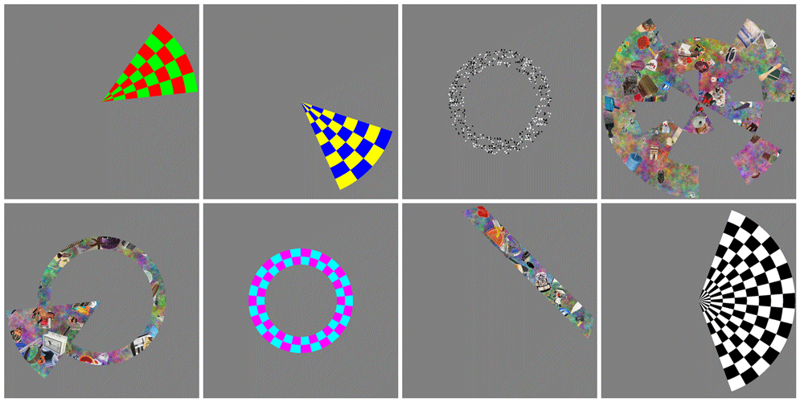

# PyRetinotopy

[English](README.md) | [日本語](README_ja.md)

PsychoPyによるレチノトピー視覚刺激呈示システムです。

**作者・責任者：番浩志**

**バージョン：0.4.0／文書改訂日：2026-11-13**

PyRetinotopyは、番浩志が開発・公開してきたMATLAB Psychtoolbox 3版Retinotopy刺激セット（[https://github.com/hiroshiban/Retinotopy](https://github.com/hiroshiban/Retinotopy)）を、PythonとPsychoPyへ移植したパッケージです。fMRIで視野位置に対応する皮質表象を調べるため、レチノトピー刺激を柔軟に定義し、単眼・両眼で呈示します。MEG、EEG、視覚心理物理実験にも利用できます。

**MATLAB Psychtoolbox 3版からPython／PsychoPy版への改訂には、OpenAIの生成AI（Codex等）のサポートを利用しています。** 作者・責任者の番浩志は、原版からの機能継承を確認し、動作チェックを行いながら開発を進めています。ソフトウェアと公開版の責任は作者が担います。

## ドキュメント

以下は日本語の文書です。各文書の先頭から対応する英語版へ切り替えられます。

- [使い方ガイド](docs/USAGE.ja.md)
- [被験者設定と既定値の継承](subjects/README_ja.md)
- [呈示時刻とブロック境界](docs/PRESENTATION_TIMING.ja.md)
- [PTB3からの機能継承と制約](docs/PTB3_FEATURES.ja.md)
- [原版設定とPython設定の対応表](docs/PTB3_PARAMETER_MAP.ja.md)
- [開始位置・走査順と旧版との互換性](docs/PTB3_PARITY.ja.md)
- [NumPy物体画像バンク](assets/object-images/README_ja.md)
- [日本語のプロジェクト・実験ガイド（PDF）](docs/PyRetinotopy_Experiment_Guide_ja.pdf)

[英語版の実験ガイド（PDF）](docs/PyRetinotopy_Experiment_Guide_en.pdf) も利用できます。

## 主な特徴

- 9刺激群・14基本モードと5種類のキャリア／課題を組み合わせた、計70のモード名に対応します。
- 単眼、左右・上下分割、anaglyph、行・列交互、2画面、quad-buffer stereoなど、15の表示方式を刺激と独立して選択できます。
- 被験者ごとのJSON設定を共有の既定値へ重ね、必要な項目だけを変更できます。
- 物体画像は独立したNumPy形式を使い、取得前の動画準備・先読み・GPUへの先行転送に対応します。
- 全刺激とブロック境界をラン開始からの累積時刻で制御し、ブロックごとの遅れが後続へ加算されることを防ぎます。
- ラン番号、同じランの再試行、結果一式の連番バックアップ、設定スナップショットと時刻・反応ログに対応します。
- プレビュー、刺激窓の再構成、BrainVoyager PRT／OLT出力を用意しています。

以下は原版Retinotopyの刺激例です。表示装置での校正・時刻・左右眼の確認は、実験条件に合わせて行ってください。



## 動作環境と導入

基本依存はPython 3.10以上、NumPy、Pillowです。刺激呈示にはPsychoPyとハードウェアOpenGLが必要です。動作確認に使用した環境はPsychoPy 2024.2.4、Python 3.10.11、Windowsです。実験には、使用するスキャナ・表示装置・反応装置を組み合わせた動作確認と校正が必要です。

PsychoPyが動作するPython環境で、プロジェクトのルートからインストールします。

```shell
python -m pip install -e .
```

旧MAT画像データの変換やMAT互換出力を使用する場合は、SciPy／h5pyを含む追加依存を導入します。

```shell
python -m pip install -e .[legacy]
```

Windows版PsychoPyに同梱されたPythonを使う場合の例を以下に示します。プロジェクトとPythonのパスは実際の配置へ置き換えてください。PsychoPy Coderでは、`PyRetinotopy.py`を開いてRunし、JSON設定を選択する方法も利用できます。

```powershell
Set-Location 'E:\PyRetinotopy\PyRetinotopy'
& 'C:\Program Files\PsychoPy\python.exe' -m pyretinotopy list
& 'C:\Program Files\PsychoPy\python.exe' -m pyretinotopy validate --subject demo --mode ccw
& 'C:\Program Files\PsychoPy\python.exe' -m pyretinotopy run --subject demo --mode ccw --run 1
```

既定ではID・mode・runを確認してから準備し、`t`または`5`の開始信号を待ちます。反応は`r`／`g`、中止はEscape／Qです。配布の表示設定は実験装置の校正済み設定ではありません。解像度、物理幅、視距離、refresh、開始信号を装置へ合わせてください。

`examples/smoke.json`は640×480の短い自動開始デモです。撮像用の設定とは区別してください。GLFW・全画面の導入例と画像呈示の準備は、[使い方ガイド](docs/USAGE.ja.md) と [日本語PDF](docs/PyRetinotopy_Experiment_Guide_ja.pdf) を参照してください。

## 刺激の種類と表示方式

| 基本モード | 刺激 |
|---|---|
| `ccw`, `cw` | 反時計回り／時計回りの楔形 |
| `exp`, `cont` | 拡大／縮小する環状刺激 |
| `bar` | 複数方向のバー走査 |
| `ccwexp`, `ccwcont`, `cwexp`, `cwcont` | 独立した周期の楔形＋環状刺激の和集合 |
| `multifocal` | 極角×離心度の領域別m系列／指定デザイン |
| `meridian` | 水平／垂直子午線の対向する楔形 |
| `lgn` | 左右半視野のLGN localizer |
| `hrf` | HRF推定用の刺激／休止 |
| `localizer` | 指定離心度帯とその補領域 |

元版と同じ接尾辞を使います。接尾辞なし＝カラーチェッカー＋刺激内の輝度検出、`f`＝チェッカー＋注視課題、`d`＝RDS＋刺激内の奥行き検出、`df`＝RDS＋注視課題、`i`＝物体画像＋注視課題です。計70通りの名前を解釈します。`*windows` は `export` で使います。

表示設定は刺激と独立しています。`mono`, `parallel`, `cross`, `dual`, `dualparallel`, `dualcross`, `topbottom`, `bottomtop`, `redgreen`, `greenred`, `redblue`, `bluered`, `interleavedline`, `interleavedcolumn`, `shutter` を用意しました。`shutter` はPsychoPyのquad-buffer stereoを利用する実装で、対応GPU・ドライバ・眼鏡の実機確認が必要です。PROPixx／Datapixx専用制御は未実装です。

## 被験者設定とランの管理

`subjects/_DEFAULT_/`が共有の既定値、`subjects/ID/`が被験者ごとの設定です。MATLABファイルの代わりにJSONを使います。読み込みは、内蔵値、`_DEFAULT_`の共通・表示・刺激ファミリー・mode別設定、被験者側の同名設定の順です。被験者ファイルには差分だけを記載でき、リストは全体を置き換えます。

```powershell
python -m pyretinotopy init-subject HB --mode ccwf
python -m pyretinotopy validate --subject HB --mode ccwf --save-config resolved-HB-ccwf.json
python -m pyretinotopy run --subject HB --mode ccwf --run 1
```

`--config FILE`は、他の既定ファイルを探索しない独立した明示設定です。継承を使う`--subject ID --mode MODE`と、取得済み条件を再現する`--config FILE`を区別してください。詳しくは [被験者設定ガイド](subjects/README_ja.md) を参照してください。

`--run N`はJSONのラン番号に優先します。既定の保存先は`subjects/ID/results/YYMMDD/MODE_run-NN/`です。同じ日・ID・mode・runを再実行すると、以前のフォルダ全体を`_old-01`、`_old-02`等へ退避し、最新の試行を元の名前へ保存します。異なるrun番号は別フォルダになります。

完走・中止・失敗の各試行を保存するため、採用するデータは`summary.json`のstatusとログで判断してください。既定は`--if-exists backup`で、`--if-exists error`では既存結果がある場合に取消します。実行中の同一取得はOSロックで保護します。

複数の取得を順に走らせる場合は、`examples/session.json`のようなセッション設定を使用します。各取得で開始信号を待ち、中止時は以降の取得を停止します。

## 呈示時刻と結果の確認

ランの第1実測flip時刻`t0`を固定し、各ブロックの目標を累積時刻から計算します。前置注視4秒・周期60秒なら、境界は`t0 + 4`、`t0 + 64`、`t0 + 124`等です。前ブロックの実測終了を次ブロックの起点にしません。

各取得に、`acquisition.json`、`config.json`、`frames.tsv`、`events.tsv`、`block_timing.tsv`、`targets.tsv`、`responses.tsv`、`summary.json`を保存します。`block_timing.tsv`の`planned_onset_s`、`actual_onset_s`、`error_s`から、後半ほど誤差が増えていないかを確認できます。

物理的な表示はrefreshで離散化され、OS・GPUのジッタも残ります。PsychoPyの同期時刻と、眼に届く光の時刻は異なるため、フォトダイオード等で装置の光学的な時刻も確認してください。詳細は [呈示時刻とブロック境界](docs/PRESENTATION_TIMING.ja.md) にまとめています。

## 物体画像と解析用出力

物体画像はNumPyバンクから読みます。元のMATファイルは任意の一度限りの変換で使用するだけで、通常の呈示では不要です。約1.96 GBの`images.npy`と準備済み動画キャッシュはGit管理から除外しています。取得前に画像バンクと動画を準備してください。

```shell
python -m pyretinotopy prepare-objects --config examples/object-images.json
python -m pyretinotopy run --config examples/object-images.json
```

画像の入手元・利用条件・配列形式は [画像バンクのガイド](assets/object-images/README_ja.md) を参照してください。

刺激窓は共通の刺激定義から出力し、TR内の露出時間を積分します。取得後は保存した設定と`frames.tsv`を使い、実測flipから再構成できます。

```shell
python -m pyretinotopy export --config examples/barf.json --output bar-windows.npz --tr 2 --resolution 128
python -m pyretinotopy export-olts --output brainvoyager-colors
```

開始位置・走査順と旧Python版の再現は [位置互換性の説明](docs/PTB3_PARITY.ja.md)、原版からの機能継承と機器依存の制約は [機能対応表](docs/PTB3_FEATURES.ja.md) を参照してください。

## 引用・参考文献・ライセンス

ソースコードには原版のBSD条件を保持しています。条件の全文は [LICENSE.txt](LICENSE.txt)、画像と依存ソフトウェアの出典・謝辞は [NOTICE.md（英語）](NOTICE.md) を参照してください。

### ソフトウェアの引用

研究ではPyRetinotopy（番浩志）の使用版またはcommitと、原版Retinotopy toolbox（番浩志）を記載してください。使用したPsychoPyの版に対応する引用も行ってください。原版URL：https://github.com/hiroshiban/Retinotopy

### 物体画像を使用する場合

画像の変換は出典や利用条件を変更しません。該当するデータベースの論文を引用してください。主なデータベース論文を以下に示します。

1. Konkle, T., & Caramazza, A. (2013). Tripartite Organization of the Ventral Stream by Animacy and Object Size. Journal of Neuroscience, 33(25), 10235-10242.

2. Konkle, T., & Oliva, A. (2012). A real-world size organization of object responses in occipito-temporal cortex. Neuron, 74(6), 1114-1124.

3. Brady, T. F., Konkle, T., Alvarez, G. A., & Oliva, A. (2008). Visual long-term memory has a massive storage capacity for object details. PNAS, 105(38), 14325-14329.

4. Konkle, T., Brady, T. F., Alvarez, G. A., & Oliva, A. (2010). Conceptual distinctiveness supports detailed visual long-term memory. Journal of Experimental Psychology: General, 139(3), 558-578.

5. Konkle, T., & Oliva, A. (2012). A Familiar Size Stroop Effect: Real-world size is an automatic property of object representation. Journal of Experimental Psychology: Human Perception and Performance, 38, 561-569.

### 原版の研究背景

Yamamoto, H., Ban, H., et al. (2009). Large- and Small-Scale Functional Organization of Visual Field Representation in the Human Visual Cortex. In Visual Cortex: New Research, 195-226.

Ban, H., Yamamoto, H., et al. (2013). Topographic processing of an occluded object and the effects of spatiotemporal contexts in human early visual areas. Journal of Neuroscience, 33(43), 16992-17002. DOI: 10.1523/JNEUROSCI.1455-12.2013

Chou, I. W. Y., Ban, H., & Chang, D. H. F. (2021). Modulations of depth responses in the human brain by object context: Does biological relevance matter? eNeuro. DOI: 10.1523/ENEURO.0039-21.2021

### 配布条件

ソースには原版のBSD条件、著作権表示、免責条項を保持しています。詳細はLICENSE.txtとNOTICE.mdを参照してください。画像データ・PsychoPy・GLFWその他の依存物には、それぞれの利用条件が適用されます。

<a name="acknowledgments"></a>

## 謝辞

### PyRetinotopyと前身のRetinotopy刺激の開発経緯

PyRetinotopyとその前身であるRetinotopyは、私が英国のUniversity of Birminghamに在籍し、Andrew Welchman博士およびZoe Kourtzi博士の指導の下で開発・使用していたレチノトピー刺激に、さまざまな改変を加えた一連のプログラムをもとにしています。ここに、お二人のご支援に深く感謝いたします。

これらの刺激の基礎となったのは、京都大学のHiroki Yamamoto博士とYoshimichi Ejima博士が、C/C++およびVisualization Toolkit（VTK、Kitware Inc.）ライブラリを用いて開発されたコードです。これらのコードはSolaris/IRIXのワークステーションで動作していました。私はお二人から、視覚刺激の作り方について多くを学びました。

これらの元の刺激をMATLABとPsychtoolboxで全面的に改変・更新し、長年にわたって新たな機能や刺激の種類を追加してきたものが、原版Retinotopyです。

最近の心理学・神経科学分野でのPythonの利用の広がりを受けて、MATLAB Psychtoolbox 3で作成した原版Retinotopyの刺激を、PsychoPyで動作するようにPythonで書き換えたものが、本パッケージPyRetinotopyです。

### PsychtoolboxとPsychoPy

原版を支えたPsychtoolboxの開発者・貢献者、David Brainard、Denis Pelli、Allen Ingling、Mario Kleiner、Richard F. Murray、Diederick C. Niehorster、Tobias Wolfの各氏に感謝します。Python版の呈示と反応記録を支えるPsychoPyの開発者と貢献者にも深く感謝します。

任意のGLFW経路にはMatthew Cutone / Open Science Toolsによる公式psychopy-glfwプラグインを使用します。NumPy、Pillow、ならびに変換・文書作成等を支えるオープンソースソフトウェアの開発者にも感謝します。

### 画像データベースとm系列

物体画像データベースの開発・公開に貢献されたTalia Konkle氏の研究グループと共同研究者の皆様に感謝します。画像を用いた研究では、上記の画像データベースの論文を引用してください。

m系列生成コードを開発されたGiedrius T. Buracas氏と、それを拡張されたThomas Liu氏に感謝します。このコードには、私自身もその後さらに修正を加えています。

### Python/PsychoPy改訂への生成AIのサポート

PyRetinotopyの開発では、MATLAB Psychtoolbox 3版RetinotopyからPython/PsychoPyへの書換えに、OpenAIの生成AI（Codexを含む）のサポートを受けました。コードの調査、設計、実装、テスト、文書作成に利用しています。

本ソフトウェアが、視覚科学・神経科学の研究と学習に役立つことを願います。

PyRetinotopyの作者・責任者である番浩志は、原版からの機能継承を確認し、動作チェックを行いながら開発を進めています。ソフトウェアと公開版の責任は作者が担います。
