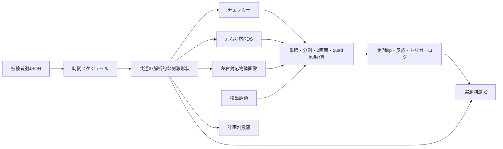

# Python版の設計と互換性

## 基本方針

原版の豊富な刺激と両眼呈示を保ちつつ、40本の呈示関数をそのまま40本へ翻訳せず、刺激形状、carrier、課題、表示装置の組み合わせとして実装します。計画、呈示、解析窓が別々の刺激を生成しないよう、共通の `Design` と `Geometry` を参照します。

| モジュール | 責務 |
|---|---|
| `modes.py` | 原版のモード名とcarrier／taskを解釈 |
| `config.py` | 単位を明示した設定、ファミリー既定値、入力検査 |
| `design.py` | 休止を含む時間区間、独立周期の複合刺激、m系列 |
| `geometry.py` | 視野座標に対するマスク、パッチIDとチェッカー極性 |
| `carriers.py` | チェッカー、両眼対応ドット、物体データ、再現可能な画像生成 |
| `gpu.py` | 先読みマスク、色反転、ElementArrayStim、stencilによる呈示 |
| `image_bank.py` | NumPy画像バンクの読取。呈示時のMAT依存を除去 |
| `convert_images.py` | 一度だけのレガシー画像変換。色・alphaを全データ照合 |
| `object_cache.py` | 取得前に左右全画像を合成し、再利用可能なNumPy動画を保存 |
| `object_stream.py` | 合成済みのバイト列だけをRAMへ先読み |
| `object_textures.py` | 先の画像を片眼ずつ転送するGPUリング |
| `backend.py` | GLFW選択、2024.2互換処理、swap後のイベント処理分離 |
| `timing.py` | ラン開始からの累積絶対時刻とブロック境界の実測照合 |
| `stereo.py` | 眼ごとの配置、反転、符号化。静止画生成の参照実装 |
| `tasks.py` | 独立乱数列の課題、実測呈示時刻に基づく反応分類 |
| `runner.py` | PsychoPyの起動、トリガー待ち、swap、入力、終了処理 |
| `outputs.py`, `export.py` | 上書き防止、取得ログ、TR積分刺激窓 |
| `legacy.py` | MATLAB設定の静的な読み取りと変換レポート |
| `session.py` | 取得列を事前検査し、順次実行 |

## 呈示と時間

チェッカーでは、形状と極性のマスクをトリガー待ちの前にGPUへ転送します。色反転や注視課題のたびにフルスクリーン画像を再転送しません。刺激内の検出対象は、小さなパッチのマスクを準備し、該当部分だけを暗くします。

RDSは `ElementArrayStim` を使い、左右で対応する位置・極性を共有します。cyclopean座標から各眼に視差の半分ずつを与え、端から端へ画像を循環移動しません。背景ドットは視差0、無相関／反相関は設定した極性相関で制御します。標準の完全相関から変える場合は、研究目的に合う設定を使用してください。

物体画像はネイティブNumPy画像バンクからRGBAを読み取り、原版と同様に背景ノイズ上へ配置します。旧MATは一度だけ別コマンドで変換し、呈示時には読みません。色・alphaを含む全値を入力と照合しました。SciPy/h5pyは任意の変換・互換出力用です。

合成、回転、拡縮、FFTノイズ、gamma、anaglyph処理は取得前に全更新分を完了させ、NumPy動画としてキャッシュします。取得中は既成のバイト列だけを最大8更新分までRAMに読みます。GPUには既定4更新分のリングを置き、先の片眼画像を1リフレッシュに最大1枚ずつ転送します。画像切替時は転送済みのテクスチャを選択するため、解像度・120枚の画像数・250 ms周期を変更する必要はありません。

乱数はepochごとに決まり、処理順に依存しません。キャッシュは画像バンク、seed、画像設定、視角換算、解像度、符号化、gamma、必要epochの変更で無効になります。未完成のキャッシュは使いません。

全刺激ファミリーで、第1実測flipを0とする累積経過時間を使います。ブロック終了時刻を次のブロックの起点にしません。次のflip予測時刻から状態を選び、実際のrefreshが名目値より速ければ状態を保持し、遅ければその時点の状態へ追いつきます。毎flipで名目フレーム番号を必ず1ずつ増やす方式も使いません。短い遅れやrefreshの微差が後半ブロックへ積み上がることを防ぎます。

`block_timing.tsv` は周期・バー走査・multifocal試行・localizerブロックの予定時刻、フレームへの割当時刻、実測時刻、誤差を保存します。複合刺激の極角周期と離心度周期も同じラン起点です。各マスク状態の切替誤差は `events.tsv` に保存します。

PsychoPy `Window.flip()` の戻り値をキーボードと同じ時計に換算して保存します。これはソフトウェアが報告したswap時刻です。網膜への光学的到達時刻は、フォトダイオード等で別途確認する必要があります。スキャナトリガーの入力時刻と第1flipの時刻を区別して保存します。

キー入力は `psychopy.hardware.keyboard.Keyboard` のタイムスタンプを利用します。RTは、予定された課題時刻ではなく、実際に対象を表示したflipから算出します。未呈示の予定課題はmissに数えません。異常終了、中止、正常終了を区別してログに残します。

## 表示方式と確認範囲

| 表示 | 実装 | 実機上の留意点 |
|---|---|---|
| mono | 1ウィンドウに片眼像 | 画素数・物理幅・距離を校正 |
| parallel/cross | 左右分割、眼の順序を切替 | 自動縮小せず、片眼領域に実寸で配置 |
| dualparallel/dualcross | 1つの横長フレームバッファを分割 | OS側の画面配置とウィンドウの幅に依存 |
| dual | 2つのscreen IDへ2ウィンドウ | swapは順次。genlockや同時走査を保証しない |
| topbottom/bottomtop | 上下分割 | 眼の順序と画面比率を確認 |
| redgreen等4種 | 輝度投影＋原版のchannel gain | レンズの透過特性、色刺激の変化を確認 |
| interleavedline/column | ネイティブ画素の偶奇をstencilで分離 | OS拡大率、画面原点、機器の眼割当を実機確認 |
| shutter | `stereo=True`、左右back bufferを描画して1回swap | quad buffer対応機器が必要。非対応時はエラー |

物体画像＋anaglyphの4通りも、輝度投影とgainを動画準備時に計算し、呈示をGPU経路に統一しました。すべての組み合わせが実機検証済みという意味ではありません。検証条件はVALIDATION文書に記録します。

Windowsの撮像用設定ではGLFW＋全画面を推奨します。PsychoPy 2024.2向けに、公式GLFWプラグインの不足するmouseVisibleを実行中のみ補い、イベント処理をflip時刻取得後へ移しています。vendorファイルやPsychoPy本体は変更しません。59.94 Hz等を整数59として列挙するnative video modeにも対応します。通常のhigh優先度に加え、PTBの最大優先度に相当する `realtime_priority` を設定でき、終了時に優先度を戻します。

PROPixx専用のblueline／VESA制御、Datapixxの機器初期化、PTBの平行ポート入力と等価な機器アダプタは含めていません。`propixxmono`／`propixxstereo` を通常の表示に黙って置換することもありません。

## 原版と一致する意味／一致を主張しない点

維持したものは、モード名、刺激ファミリー、視差の符号、課題の種類、楔形と環状幅の関連、走査方向、独立した複合周期、m系列、主な既定総時間、物体画像データの利用です。

次の違いは意図的、または検証途中です。

- v0.3.0では開始角パラメータをPTB3の画像座標（正が時計回り）として解釈し、内部の視野座標（y上向き、正が反時計回り）へ変換。ccwの全配列逆順、複合環の16位置と幅、LGNの水平反転、multifocalの領域方向を原版の式へ合わせた。全70モードの連続座標マスクを照合済み。MATLAB実行画像の画素一致は未検証。
- 画素中心で解析的に判定し、角度・バーを画像の事後回転で生成しない。PPDを整数へ丸めないため、原版と境界の1画素差が生じ得る。
- multifocalの領域IDは既定で重複を修正。`multifocal_indexing: "ptb3"` で原版のゼロ位相・全周条件の重複を再現できる。設定を保存して過去の実験と区別する。
- v0.4.0の既定は原版の課題スロット方式。fixtaskfreq、暗色、通常スロット、刺激内の半期間窓を継承する。秒によるinterval方式も選べる。乱数列の一致は主張しない。
- RDSのドット中心密度の意味は保持するが、乱数、ドットのラスタライズ、遮蔽処理はMEXと画素単位では一致しない。
- 物体画像の配置、回転、視差、alphaを使うが、画像補間、ノイズの正規化、画像列の乱数は原版と同一ではない。
- gammaは逆べき乗または任意のnative JSON LUTをプログラム内に適用し、dualの第2画面表にも対応する。OS全体のgamma rampを書き換える処理は置換した。
- onset markerは既定で原版の位置保持時間の半分。marker_timing=fixedでは任意秒を指定できる。
- 解析窓はTR内の露出時間を積分する。原版のTRごとのフレーム取り出し・丸めと異なる場合がある。
- BrainVoyager PRT出力と原版6種類のOLTを継承。眼球計測の取込、音声、MEX・m2html・汎用解析ユーティリティの全関数を同名で移植してはいない。

## 設定と開発の方針

`subjects/_DEFAULT_/` に共通・表示・9刺激ファミリーのJSON既定値を配置しました。`--subject ID --mode MODE` は既定ファイルから被験者差分を重ね、未指定項目を補います。設定元の一覧と展開済み取得設定を保存します。`--config FILE` は既定フォルダを探索しない独立設定として維持します。詳細は [被験者設定ガイド](../subjects/README.md) を参照してください。

1. コードの説明は英語docstring、利用・移植上の説明は日本語文書を基本とする。公開配布前に英語の利用文書も追加できる構成にする。
2. 新しい刺激を追加する場合は、まず `Design` と `Geometry` を拡張し、表示・解析に別の式を増やさない。
3. 秒／degree／arcmin／pixel／RGBをフィールド名かdocstringに明記する。msec等の自動推測をしない。
4. 科学的な刺激条件を変える修正には、向き、時間、眼の対応、解析窓の独立した確認を加える。コードをそのままなぞるテストを増やさない。
5. 画面全体、半画面、2画面のPPDを混同しない。必要画素数が足りないときに自動で縮小しない。
6. 乱数streamは課題・RDS・物体等で分離し、設定とseedを結果へ保存する。
7. OpenGLは主スレッドで操作する。旧MATの読取・nativeバンクへの変換は取得と分離する。画像合成は取得前に完了し、取得中は既成画像を先読みする。準備が追いつかない場合はその場で合成せず、ログを残して停止する。
8. OSロックで実行中の同一取得を保護する。再実行時は既存取得全体を連番退避して新規フォルダを作る。MATLAB側のデータは変更しない。
9. 機器がない状態で「同期済み」「立体視検証済み」と表示しない。ソフトウェア試験と実機試験の記録を分ける。

## 次の実験室での検証

原版の計算式による開始位置・走査・休止は、v0.3.0で全70モードを照合しました。[位置対応の記録](PTB3_PARITY.ja.md) を参照してください。次は同一の被験者設定でMATLABを実行して代表フレームと全時系列を出力し、画素境界・補間・左右割当まで照合します。multifocalの領域番号をcorrected / ptb3のどちらで運用するかを記録してください。

その後、使用する表示装置とスキャナで、gamma、画面の物理寸法、左右反転、フォトダイオードのマーカー、実トリガー、長時間runのflip分布を確認します。2画面やシャッターの場合は各眼を独立して光学計測し、その機器・OS・GPU・PsychoPyバージョンを記録します。今回実装したソフトウェア経路の確認は、これらの機器試験を代替しません。

参照した一次資料: [PsychoPy Window](https://psychopy.org/api/visual/window.html)、[Keyboard](https://psychopy.org/api/hardware/keyboard.html)、[ImageStim](https://psychopy.org/api/visual/imagestim.html)、[ElementArrayStim](https://psychopy.org/api/visual/elementarraystim.html)。実装時にはこのPCの2024.2.4ソースも確認しました。

## v0.4.0での全機能再調査

46の呈示入口・40の呈示関数、既定11ファイル、設定参照96項目を一覧化しました。注視点2／3の実形状、原版の暗色64/255、背景の周辺ガイド、課題頻度・半期間、色列の開始／休止、RDSの対向視差面、マーカー、任意gamma表、実測refresh、実行前確認、ラン引数・再実行バックアップ、PRT／OLT、全位置プレビューを改訂しています。[継承表](PTB3_FEATURES.ja.md) と [全設定対応](PTB3_PARAMETER_MAP.ja.md) に区分を記録しました。

v0.3.0以前の保存config.jsonはsummaryの版情報により、未指定のtask schedule・注視点描画・マーカー・時間時計・RDS割当を旧方式へ戻して再現します。通常の設定は新既定値を採用します。新設定はすべて取得設定へ保存します。
